# Bazarr (unofficial) for Android

A Flutter app to manage subtitles on your own [Bazarr](https://www.bazarr.media) server.

- Bottom tabs: **Series**, **Movies**, **History**, **Jobs**, **More**
- Browse the library, request automatic searches for missing subtitles, download manually selected results, delete or sync subtitles, run tasks and manage the job queue
- Preview, translate, clean up and retime downloaded subtitles, choose sync references and settings, or extract embedded tracks
- Primary + secondary server URL with API key; demo mode included
- Open Connection settings from the top bar on **More**, even when the server is unavailable

Not affiliated with the Bazarr project. See [.docs/](.docs/README.md) and [PRIVACY_POLICY.txt](PRIVACY_POLICY.txt).

## Screenshots

<p align="center">
  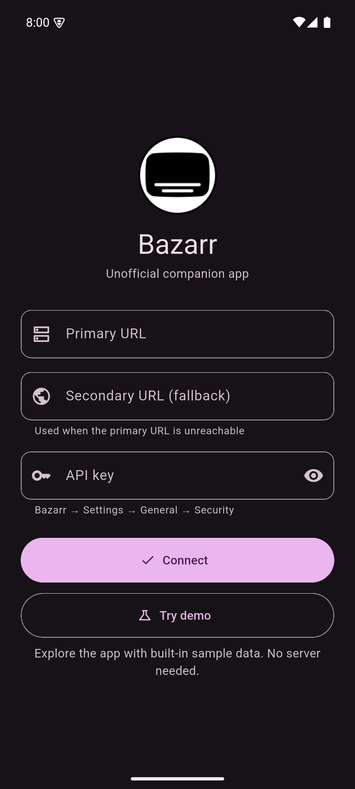
  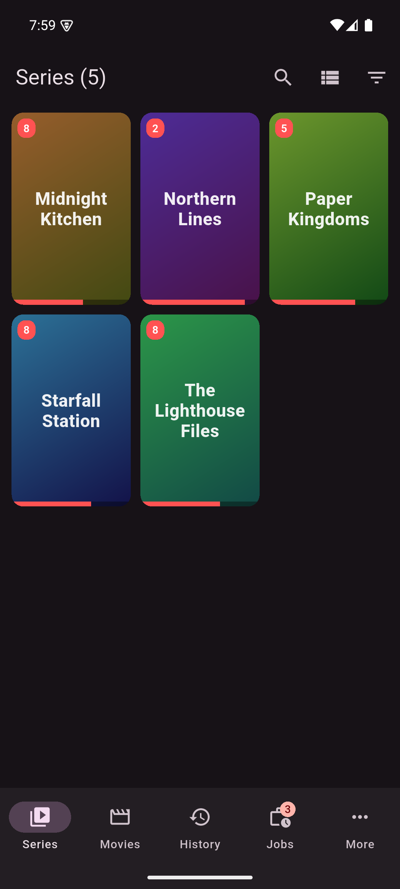
  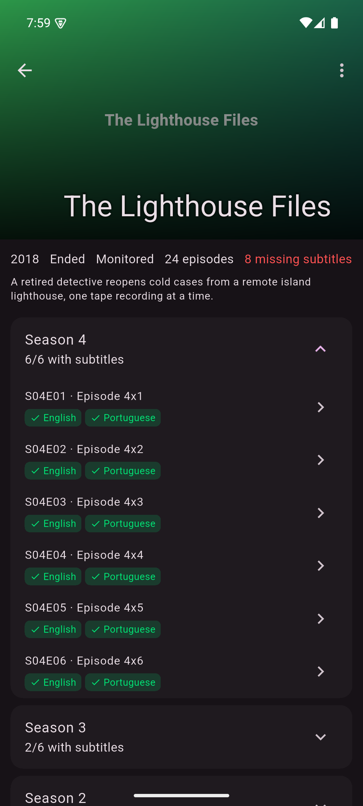
  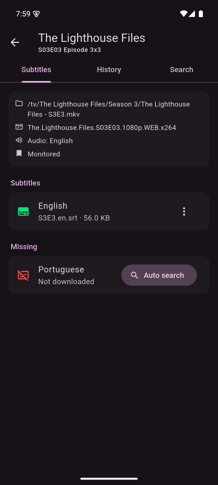
</p>
<p align="center">
  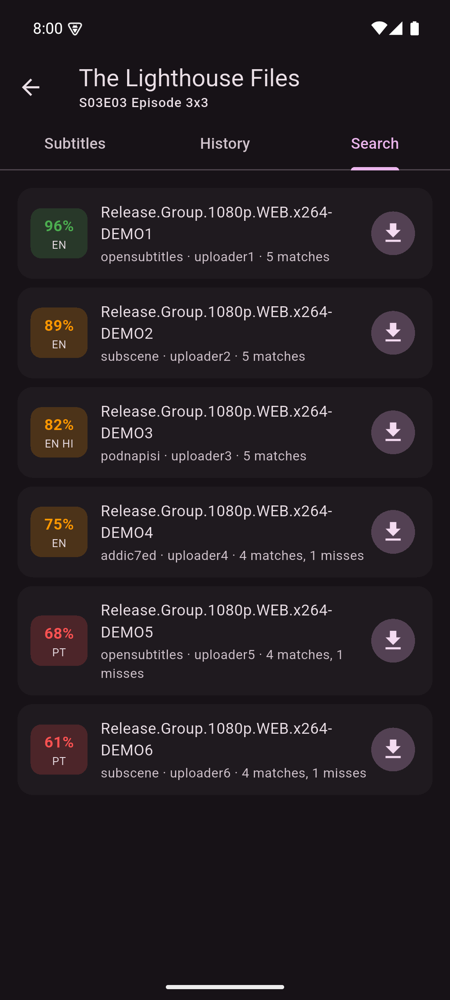
  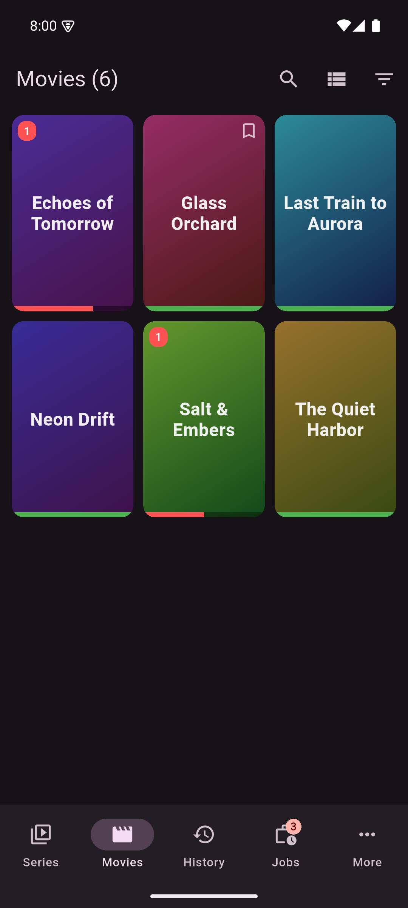
  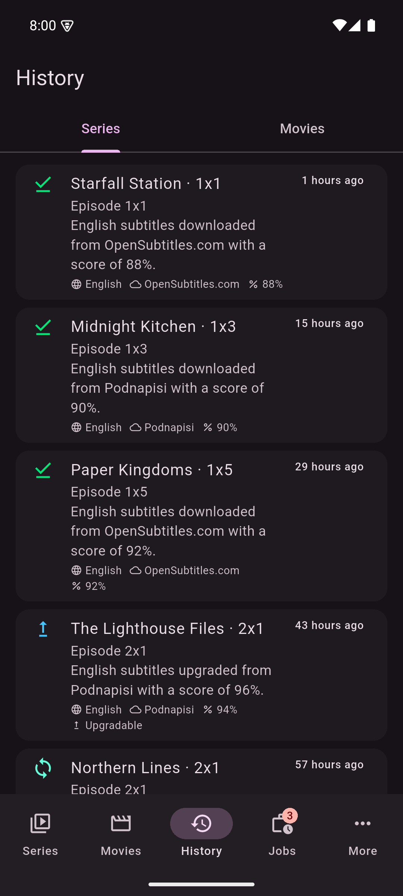
  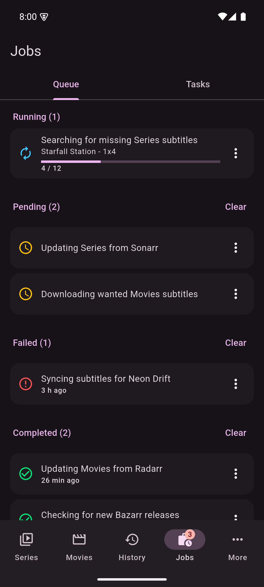
</p>
<p align="center">
  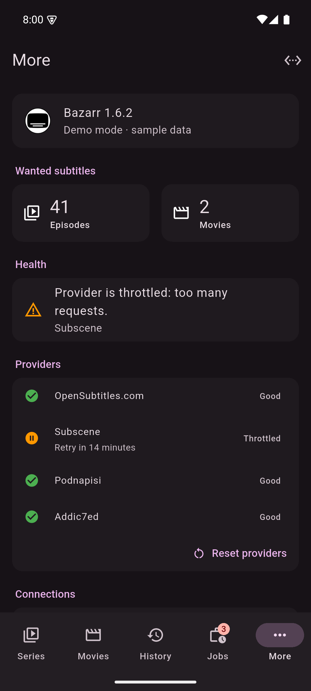
  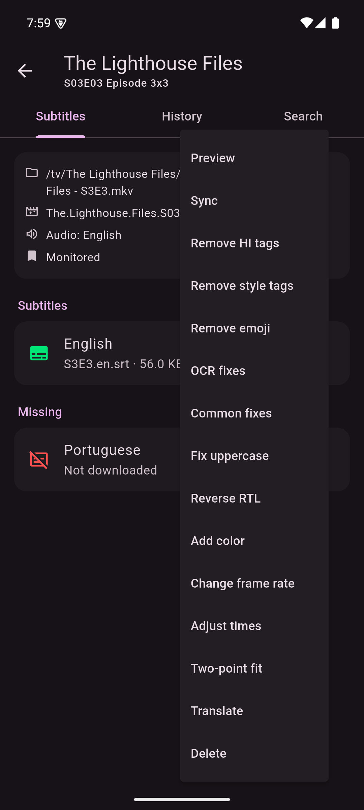
  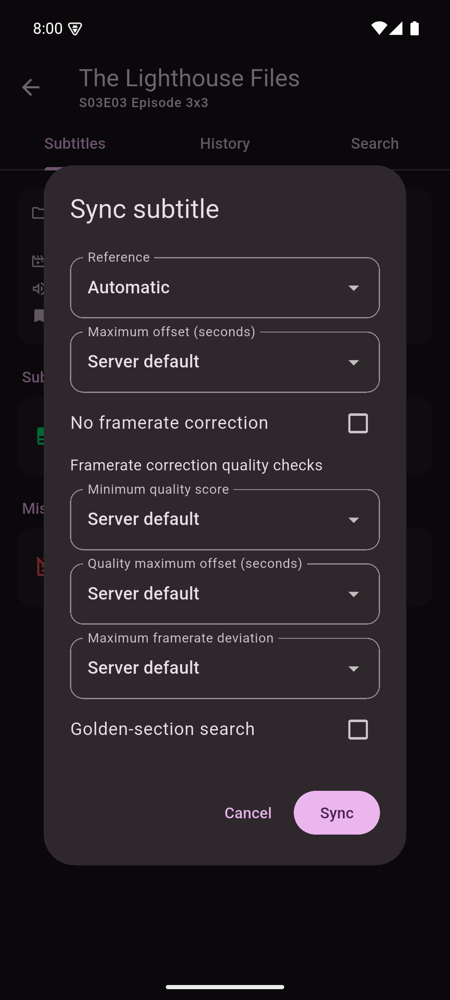
  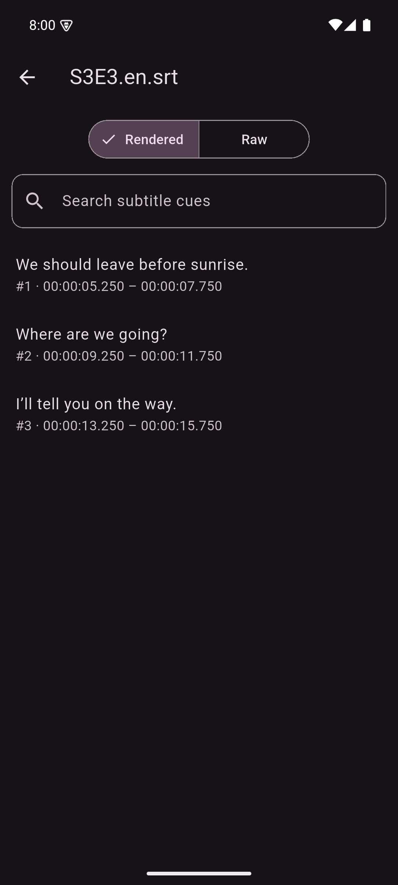
</p>

```
flutter pub get
flutter run
```
